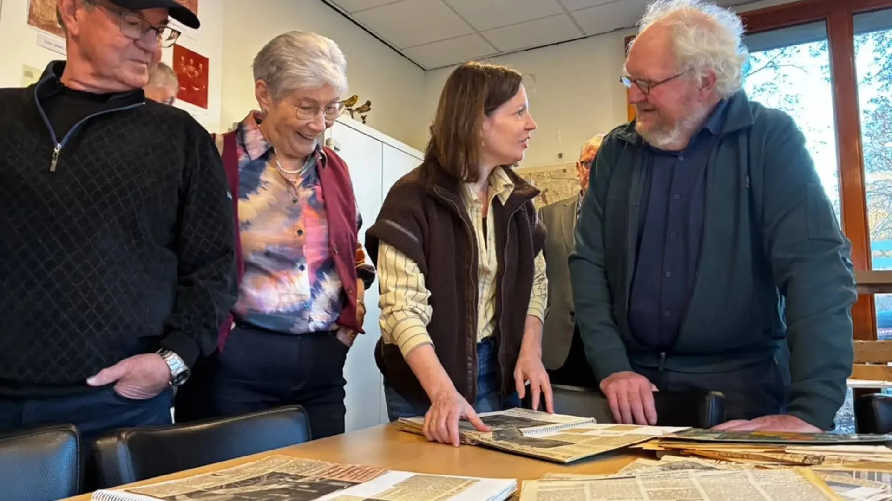
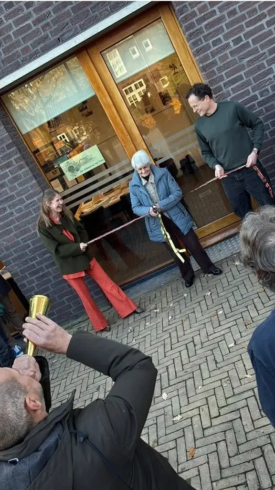
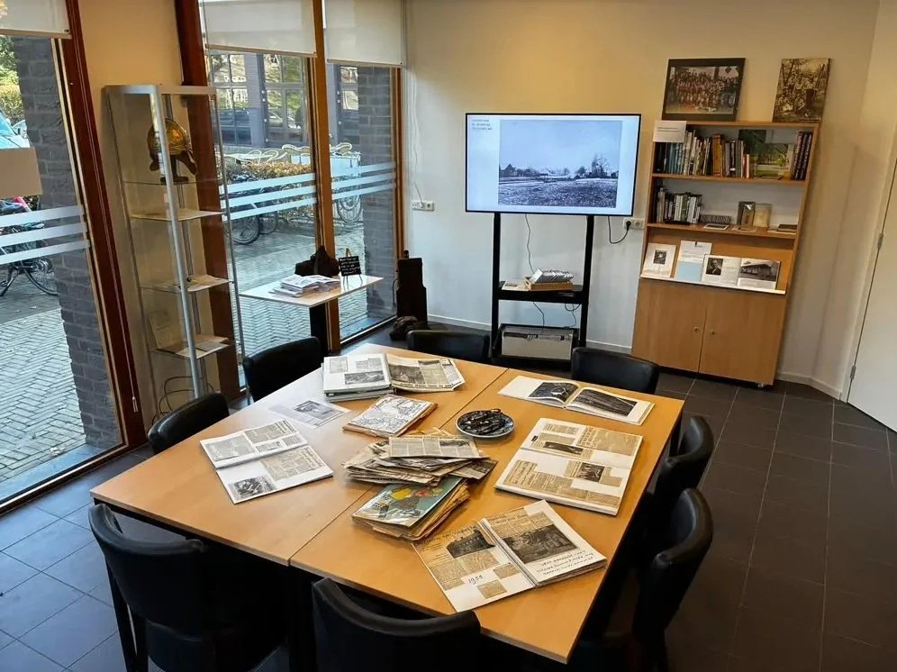

# hvt-huisopen

> Bron: helenaveenvantoen.nl

Feestelijke opening van Het Helenaveen van Toen-huis: dorpsgeschiedenis komt tot leven

24 november 2026

Het Helenaveen van Toen-huis is afgelopen zondag onder grote belangstelling feestelijk geopend in Dorpscentrum de Gouden Helm. Het lint werd vastgehouden door wethouder Janke van Dijk en Jankees van Woezik van Dorpsraad Helenaveen, terwijl het symbolisch werd doorgeknipt door Riki van Mullekom-Bakker, het oudste lid van werkgroep Het Helenaveen van Toen.

Het was een bijzonder moment voor Helenaveen, aangezien de geschiedenis van het dorp en de verhalen van de inwoners nu een eigen plek hebben gekregen. Het doel van de ruimte in de voormalige streek- en versproductenwinkel de Peelbascule is een thuis bieden voor inwoners, oud-inwoners en anderen die geïnteresseerd zijn in de dorpshistorie en het behouden ervan.

Wisselende tentoonstelling“Het moet een plek worden waar we regelmatig te vinden zullen zijn”, aldus Jan van Woezik. Hij is lid van de werkgroep Het Helenaveen van Toen, die het initiatief nam voor het museum. “Waar mensen hun oude foto’s en documenten veilig naartoe kunnen komen brengen. Enerzijds om ze in bewaring te geven of juist om ze meteen te laten scannen, zodat ze weer mee naar huis kunnen. Natuurlijk vinden we het leuk als mensen met hun verhalen naar ons toe komen en de regelmatig wisselende tentoonstelling komen bekijken”.

Tijdens de opening benadrukte wethouder Van Dijk het belang van de geschiedenis van Helenaveen voor de ontwikkeling van de gemeente Deurne. Sinds de aanleg van de Helenavaart in 1853 groeide de turfwinning uit tot een belangrijke economische motor voor de regio. Ook het behoud van varend erfgoed kreeg aandacht: Hans van Neerven en Huub Kleintjes bouwen een replica van het historische turfschip ‘Janske Pardoel’, die in 2028 te water moet worden gelaten ter gelegenheid van het 175-jarig bestaan van Helenaveen.

Meer dan een archiefHet Helenaveen van Toen-huis wil meer zijn dan een archief. Het wordt een locatie waar herinneringen worden bewaard, verhalen worden doorgegeven en nieuwe generaties kennismaken met de historie van het dorp. De grote belangstelling bij de opening laat volgens de vrijwilligers zien dat deze geschiedenis nog altijd leeft.

De leden van werkgroep Het Helenaveen van Toen zijn vanaf december elke even week van het jaar op woensdagmiddag aanwezig op de Oude Peelstraat 3. Mensen die spullen hebben om af te geven of in te scannen, zijn dan van harte welkom. Geïnteresseerde vrijwilligers kunnen zich melden bij één van de werkgroepleden. Dat kan ook via info@helenaveenvantoen.nl.

Foto’s: Werkgroep Het Helenaveen van Toen

